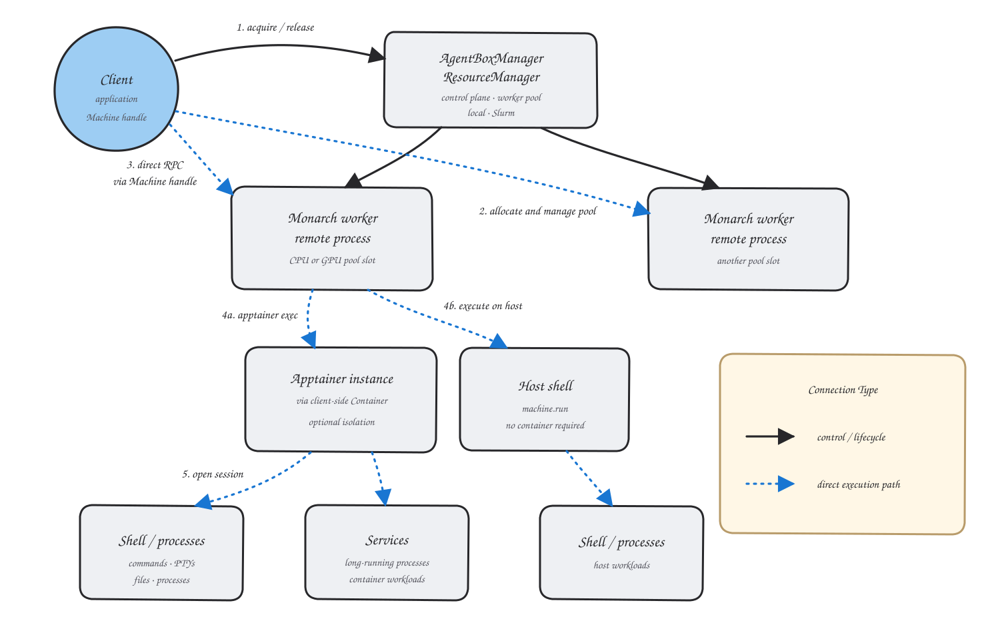
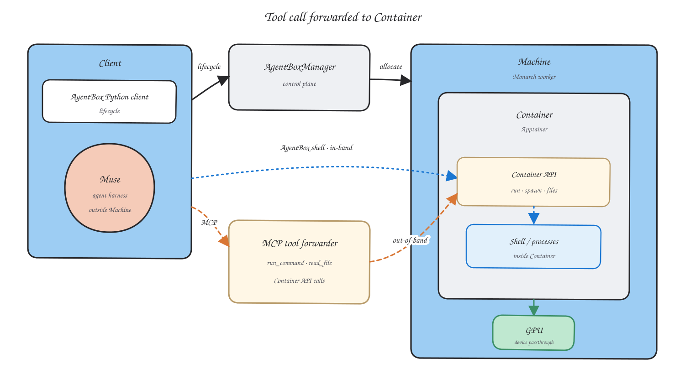
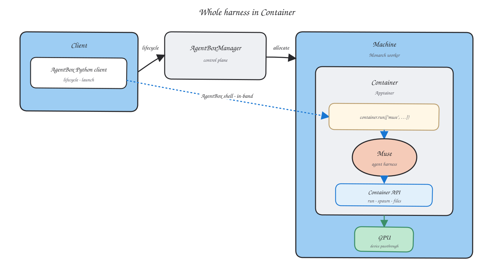

# Core concepts

AgentBox separates resource placement, remote execution, and container
isolation, so application code does not depend on whether a worker is a local
process or a [Slurm](https://slurm.schedmd.com/overview.html) job.
AgentBox assumes a scheduler (e.g., Slurm), will provide a handle to a "machine"
(which, in practice, may itself be only a slice of a machine).
That machine can then spawn containers, which we assume is `apptainer`.
We usually refer to one AI agent inside a container as a "worker".
In a multi-agent system, there can be many machines, containers, and agents in
use at the same time.
Often, agents consume or produce files (e.g., for code developement).
Below, we map these concepts into AgentBox abstractions.

## Control flow

1. `AgentBoxManager` creates a worker pool through a `ResourceManager`
   (local subprocesses or a Slurm job array).
2. Acquiring a pool slot returns a client-side `Machine` handle backed by a
   Monarch process mesh on that worker.
3. Commands, processes, and file transfers then flow directly to the worker,
   not through the scheduler.
4. A `Container` on that `Machine` runs the same operations inside an
   Apptainer instance via `apptainer exec`; Monarch stays on the host.

`Machine` and `Container` both implement
[`ExecutionTarget`](../src/agentbox/actors/target.py), so code written
against one runs unchanged on the other:

| Operation | Purpose |
| --- | --- |
| `run` / `arun` | Run a command to completion and capture its output |
| `spawn` | Start a long-running process with pipes, or with `pty=True` a terminal |
| `upload` / `download` (+ async) | Copy a file or directory to or from the target |

A `str` command runs through `/bin/sh -c`; a `list` is executed as argv.

The control path is implemented in
[`manager.py`](../src/agentbox/actors/manager.py),
[`connector.py`](../src/agentbox/actors/connector.py), and
[`resource_managers`](../src/agentbox/actors/resource_managers); the
execution path in [`machine.py`](../src/agentbox/actors/machine.py),
[`container.py`](../src/agentbox/actors/container.py), and
[`remote`](../src/agentbox/remote).

## File transfer

`upload`, `download`, and `Machine.copy_to` copy files and directories
directly between hosts, over Ethernet or RDMA. See
[`file_transfer.py`](../src/agentbox/remote/file_transfer.py),
[`chunk_io.py`](../src/agentbox/remote/chunk_io.py),
[`rdma.py`](../src/agentbox/remote/rdma.py), and
[`tree_archive.py`](../src/agentbox/remote/tree_archive.py).

## Agentic workload patterns

AgentBox does not require a particular agent harness. The main choice is
whether the harness stays with the client and forwards tool calls into a
container, or runs inside the container with its tools.

### Forward tool calls into the container

The harness runs on the client and turns each tool call into `container.run`,
`spawn`, or file operations, directly or through a forwarder such as an
[MCP](https://modelcontextprotocol.io/) server. Orchestration stays
client-side while model-selected commands execute inside the isolation
boundary. Evaluation harnesses
that drive one container per trial typically follow this pattern; see
[Extending AgentBox](api.md#extending-agentbox).

### Run the whole harness in the container

The client launches a prebuilt harness inside the container, where it runs
its own tools. The client keeps lifecycle control. The
[Claude Code](../examples/harnesses/claude_container.py),
[Codex](../examples/harnesses/codex_container.py), and
[Muse Code](../examples/harnesses/muse_container.py) examples show this pattern.
The Claude Code and Codex examples also use a worker-host proxy
([`host_llm_bridge.py`](../examples/harnesses/host_llm_bridge.py)) that keeps the
provider API key out of the container.

## Resource lifecycle

Each usable worker is a pool slot. `acquire_machine()` leases a slot as a
`Machine` and returns it to the pool on exit; containers and processes created
from that `Machine` must not outlive the lease. Nested context managers make
this explicit. `scale_by()` grows or shrinks the pool, `pool_status()` reports
it, and `shutdown()` (or leaving the manager's context) stops all workers.

On Slurm, the scheduler owns placement and job state; Monarch provides
communication after placement. See
[`slurm_array.py`](../src/agentbox/actors/resource_managers/slurm_array.py).

## Sync and async

Every blocking operation has an async counterpart (`run`/`arun`,
`acquire_machine`/`aacquire_machine`, `start`/`astart`, ...). Use the async
forms inside an event loop; sync calls block on Monarch futures.
